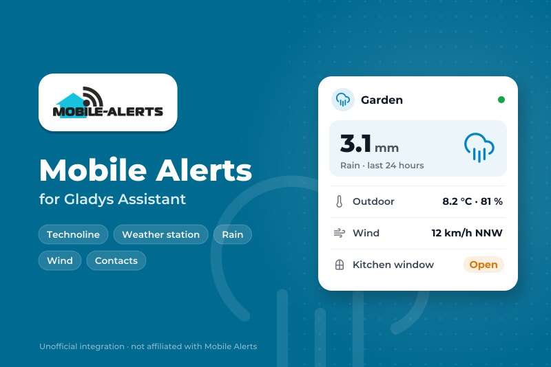
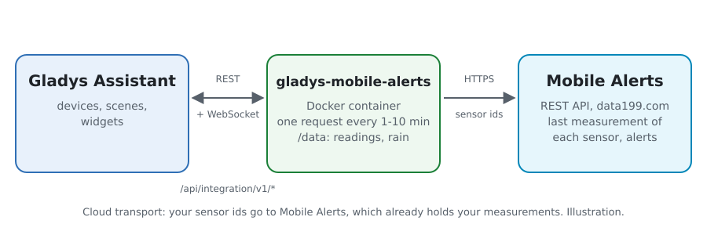
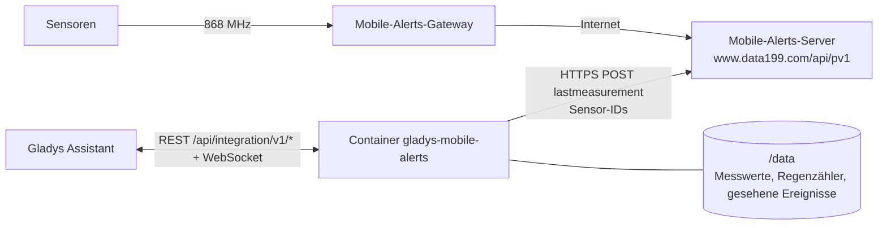
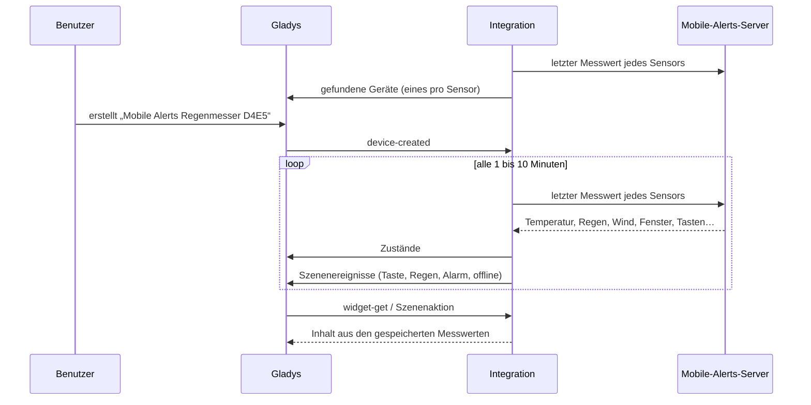
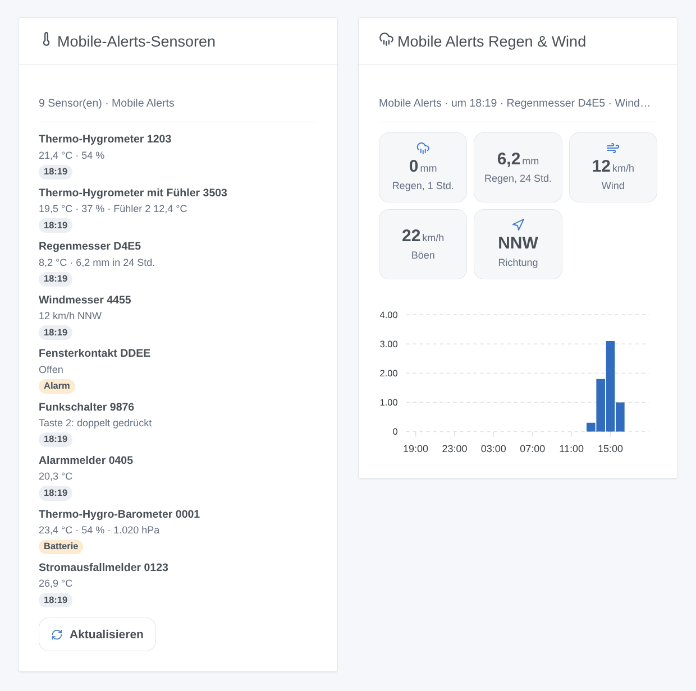

# Gladys Mobile Alerts

[English](README.md) · [Français](README.fr.md) · **Deutsch** · [Español](README.es.md)

[](LICENSE)
[](https://github.com/William-De71/gladys-mobile-alerts/releases)
[](https://github.com/William-De71/gladys-mobile-alerts/actions/workflows/release.yml)
[](https://gladysassistant.com)



Externe Integration für [Gladys Assistant](https://gladysassistant.com) für die **[Mobile-Alerts](https://mobile-alerts.eu)**-Sensoren (verkauft von Technoline, La Crosse, ELV…): Temperatur, Luftfeuchtigkeit, Regen, Wind, Fensterkontakte, Funkschalter und Alarmmelder, mit Szenen und Dashboard-Widgets. Sie liest die offizielle REST-API von Mobile Alerts mit den IDs deiner Sensoren, ganz ohne Konto.

## Funktionen

- **Ein Gerät pro Sensor** (bis zu 50), nach seiner Art benannt: Temperaturen und Luftfeuchtigkeiten (Fühler und Zusatzsensoren inklusive), Luftqualität, Luftdruck, Regen der letzten Stunde und der letzten 24 Stunden, Windgeschwindigkeit, Böen und Windrichtung, Fensterkontakt, die vier Tasten eines Funkschalters, Rauchalarme, schwache Batterie.
- **4 Szenenauslöser**, **1 Szenenaktion** und **2 Dashboard-Widgets** (unten).
- Eine Anfrage alle 1 bis 10 Minuten (nach Wahl) liest alle Sensoren, 20 IDs pro Anfrage.
- Optional: Die Phone-ID der Mobile-Alerts-App macht die in der App eingestellten Alarme zu Szenenauslösern.
- Nur lesend. Schaltflächen der Konfiguration: jetzt lesen, Diagnose.
- Vier Sprachen überall: Englisch, Französisch, Deutsch, Spanisch.

## Funktionsweise





Die Sensoren senden ihre Messwerte per Funk an das Mobile-Alerts-Gateway, das sie an den Mobile-Alerts-Server weiterleitet. Die Integration liest dort den letzten Messwert jedes Sensors (`POST /device/lastmeasurement`). Die API kann deine Sensoren nicht auflisten: Du gibst ihre IDs an. Der Regen der letzten Stunde und der letzten 24 Stunden kommt aus dem Zähler des Regenmessers, der 25 Stunden lang aufbewahrt wird. Jeder neue Messwert wird mit dem vorherigen verglichen, um die Szenenauslöser auszulösen.

Der Server lehnt eine ganze Anfrage wegen einer einzigen unbekannten ID ab (400) und sperrt die Adresse für 15 Minuten nach 5 ungültigen Anfragen in 15 Minuten. Eine abgelehnte Anfrage wird daher aufgeteilt, ID für ID, ohne je mehr als 4 ungültige Anfragen in 15 Minuten zu stellen; eine unbekannte ID bleibt außen vor, bis sich die Konfiguration ändert oder **Jetzt lesen** gedrückt wird.



### Transport

Nur Cloud (`"transports": ["cloud"]`): Der Katalog zeigt das Cloud-Abzeichen. Die Integration kontaktiert `www.data199.com` über HTTPS mit den IDs deiner Sensoren (und der Phone-ID, wenn du sie angibst); Mobile Alerts hat ihre Messwerte bereits. Das Gateway hat keine lokale API, daher gibt es keine Schaltfläche „Lokale Verbindung bevorzugen“.

## Geräte und Funktionen

| Funktion                              | Kategorie / Typ                | Hinweis                                |
| ------------------------------------- | ------------------------------ | -------------------------------------- |
| Temperatur                            | `temperature-sensor/decimal`   | °C                                     |
| Temperatur (Fühler 2 bis 4)           | `temperature-sensor/probe`     | °C, nicht im Raummittelwert            |
| Luftfeuchtigkeit (und Fühler 2 bis 4) | `humidity-sensor/decimal`      | %                                      |
| Luftqualität (CO₂-Äquivalent)         | `co2-sensor/integer`           | ppm                                    |
| Luftdruck                             | `pressure-sensor/decimal`      | hPa                                    |
| Regen, letzte Stunde / letzte 24 Std. | `precipitation-sensor/decimal` | mm/h, mm/Tag, aus dem Zähler           |
| Regen                                 | `rain-sensor/binary`           | Regen in den letzten 30 Minuten        |
| Windgeschwindigkeit, Böen             | `speed-sensor/decimal`         | m/s                                    |
| Windrichtung                          | `angle-sensor/decimal`         | Grad, 16 Sektoren                      |
| Fenster                               | `opening-sensor/binary`        | 1 geschlossen, 0 offen                 |
| Rauch                                 | `smoke-sensor/binary`          | Alarmmelder, nur mit der Phone-ID      |
| Taste 1 bis 4                         | `button/click`                 | 1 Klick, 2 Doppelklick, 6 langer Klick |
| Batterie schwach                      | `battery-low/binary`           |                                        |

Ein Gerät pro Sensor, `should_poll: false`, angeboten, sobald er geantwortet hat, mit dem, was er misst. Ein nicht angeschlossener Fühler veröffentlicht nichts: Es wird kein Wert erfunden. Eine einmal angebotene Funktion verschwindet nie. Die externen IDs stammen aus einem Hash der Sensor-ID: Die ID selbst erscheint nie in Gladys.

## Szenenauslöser, Aktionen und Widgets



**Auslöser**

- **Taste gedrückt**: Eine Taste eines Funkschalters wird gedrückt. Filter: Sensor, Taste (1-4), Druck (kurz, doppelt, lang). Der Druck wird bei der nächsten Abfrage erkannt (1 bis 10 Minuten).
- **Regen beginnt**: Ein Regenmesser zählt Regen nach mindestens einer Stunde ohne.
- **Alarm der App**: Ein in der Mobile-Alerts-App eingestellter Alarm beginnt oder endet (Temperatur, Feuchte, Luftqualität, Luftdruck, Regen, Wind, Fenster, Rauch, Stromausfall). Phone-ID nötig. Filter: Sensor, Alarm, Zustand.
- **Sensor offline oder zurück**: Der Server hat seit 3 Stunden nichts von einem Sensor empfangen, oder wieder. Filter: Sensor, Zustand.

**Aktion**: einen Sensor lesen (alle Werte, Uhrzeit, online oder nicht, Satz `summary`).

**Widgets**: **Mobile-Alerts-Sensoren** (jeder Sensor mit seinen Werten und einem Abzeichen: offline, Rauch, Batterie schwach, Alarm oder die Uhrzeit; Aktualisieren) und **Mobile Alerts Regen & Wind** (Regen der letzten Stunde und 24 Stunden, Wind, Böen, Richtung, Regen pro Stunde).

**Beispiele**

- Wenn **Taste 1 des Schalters zweimal gedrückt wird** → die Szene „Film“.
- Wenn **es zu regnen beginnt** → das Dachfenster schließen und benachrichtigen.
- Wenn **das Küchenfenster zu lange offen bleibt** (Alarm der App) → eine Nachricht.

## Voraussetzungen

- Gladys Assistant **5.3.0** oder neuer (Katalog-Schlüsselwörter). Ältere Instanzen können die Integration nicht installieren.
- Mobile-Alerts-Sensoren und ein Mobile-Alerts-Gateway (oder ein Sensor, der sich selbst verbindet), in der Mobile-Alerts-App eingerichtet.
- Die ID jedes Sensors: 12 Zeichen, auf seinem Aufkleber und in der App.

## Installation

- **Aus dem Store** von Gladys (Integrationen → Externe Integrationen), mit einem Klick, sobald indiziert.
- **Über die URL des Repositorys**: `https://github.com/William-De71/gladys-mobile-alerts`.
- **Entwicklermodus**: Das Image lokal bauen (`docker build -t gladys-mobile-alerts .`) und in Gladys installieren.

## Konfiguration

| Feld              | Standard    | Rolle                                                                       |
| ----------------- | ----------- | --------------------------------------------------------------------------- |
| Sensor-IDs        | —           | Die ID jedes Sensors, getrennt durch Kommas oder Zeilenumbrüche; bis zu 50. |
| Phone-ID der App  | —           | Optional (geheim): fügt die Alarme der App und die Rauchalarme hinzu.       |
| Lesen alle        | 2 Minuten   | 1, 2, 5 oder 10 Minuten.                                                    |
| Sprache der Texte | automatisch | Namen der Geräte und Texte der Szenen.                                      |

## Verwendung

1. Gib die IDs deiner Sensoren ein (und die Phone-ID, wenn du die Alarme der App möchtest), dann speichern.
2. Drück auf **Jetzt lesen**, um die Werte jedes Sensors zu sehen.
3. Erstelle im Tab **Entdecken** die Geräte „Mobile Alerts …“.
4. Füge die Widgets **Mobile-Alerts-Sensoren** und **Mobile Alerts Regen & Wind** einem Dashboard hinzu und baue Szenen mit den Auslösern oben.

## Entwicklung

```bash
npm install
npm test                       # node --test, ohne je das Netzwerk zu berühren
npm run lint && npm run format:check
npx github:GladysAssistant/integration-store . --skip-image-check
scripts/build-cover.sh         # cover.jpg aus docs/assets/cover.svg
docs/illustrations/render.sh   # docs/assets/widgets.<Sprache>.png
node .github/scripts/release.mjs next
```

Lokal liest das SDK `GLADYS_HOST_API_URL`, `GLADYS_INTEGRATION_TOKEN` und `GLADYS_INTEGRATION_SELECTOR`; `DEBUG=gladys-integration-sdk` zeigt die Logs des SDK und prüft jeden Widget-Inhalt. Die Tests nutzen einen falschen Mobile-Alerts-Server, der sich wie der echte verhält (`test/helpers/fake-api.js`), nach der [Dokumentation der REST-API](https://mobile-alerts.eu/info/public_server_api_documentation.pdf). Die Regeln des Projekts stehen in [CLAUDE.md](CLAUDE.md).

## Veröffentlichungsprozess


Jeder Merge auf `main` startet die CI und berechnet dann die Version aus den [Conventional Commits](https://www.conventionalcommits.org/) seit dem letzten Tag: `feat` → Minor, `fix` / `perf` → Patch, `!` oder `BREAKING CHANGE` → Major (ein Minor unter 1.0.0); `docs`, `chore`, `ci`, `test`, `style`, `refactor`, `build` allein veröffentlichen nichts. Der Abschnitt des Changelogs wird erzeugt, der Tag gepusht, das Multi-Architektur-Image gebaut, dann erhält `main` den Versions-Commit, das GitHub Release wird erstellt und ein letzter Job prüft das öffentliche Image, den Validator des Stores und das Topic.

- Der Titel des Pull Requests wird zum Squash-Commit und dann zur Zeile im Changelog: auf Englisch, für den Benutzer (`pr-title.yml` prüft ihn). `CHANGELOG.md` nie von Hand bearbeiten.
- 1.0.0 ist eine Entscheidung: Actions → Release → Run workflow mit `release-as: 1.0.0`. `dry-run` zeigt Version und Notizen, ohne zu veröffentlichen.
- **Geschützter Branch**: Die Veröffentlichung pusht ihren Commit mit `GITHUB_TOKEN` auf `main`. Mit einem Ruleset, das Pull Requests oder Statusprüfungen auf `main` verlangt, GitHub Actions zur Bypass-Liste hinzufügen (oder über eine GitHub App pushen), sonst scheitert der Veröffentlichungsjob mit Anweisungen.
- Nach der ersten Veröffentlichung das Paket `ghcr.io` öffentlich machen (Package settings → Change visibility), sonst kann Gladys es nicht herunterladen.

## Fehlerbehebung

Siehe [docs/de.md](docs/de.md#fehlerbehebung). Melde Probleme mit den Versionen von Gladys und der Integration und den Zeilen der Schaltfläche **Diagnose**.

## Mitwirken

Issues und Pull Requests sind willkommen. Führe `npm run format:check && npm run lint && npm test` aus, bevor du einen Pull Request öffnest, und lass alle externen IDs und gespeicherten Schlüssel unverändert (siehe [CLAUDE.md](CLAUDE.md)).

## Sicherheit

Siehe [SECURITY.md](SECURITY.md): Sicherheitslücken bitte privat melden. Die Sensor-IDs geben Zugriff auf ihre Messwerte: Sie werden nur über HTTPS an `www.data199.com` gesendet, und die Logs, die Diagnose und `/data` zeigen nur die letzten vier Zeichen einer ID oder ihren Hash. Die Phone-ID ist ein `secret`-Feld von Gladys und wird nie protokolliert. Die Integration läuft nur lesend, ohne Root-Rechte, in ihrem Container.

## Kommende Screenshots

Die Bilder oben sind Illustrationen, keine Screenshots. Echte Screenshots kommen nach `docs/assets/screenshots/` (PNG, 1280 × 800): `configuration.png`, `discovery.png`, `device.png`, `scene.png`.

## Lizenz

[Apache License 2.0](LICENSE) — siehe auch [NOTICE](NOTICE). Daten bereitgestellt von Mobile Alerts; diese Integration ist weder mit Mobile Alerts noch mit Technoline oder La Crosse verbunden. Danke an die Dokumentation und das SDK von Gladys und an Mobile Alerts für seine öffentliche REST-API.
