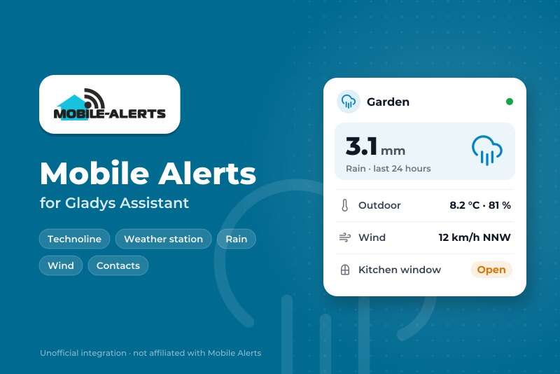
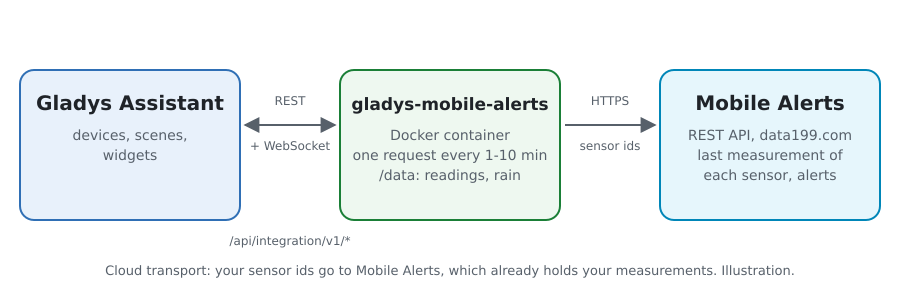
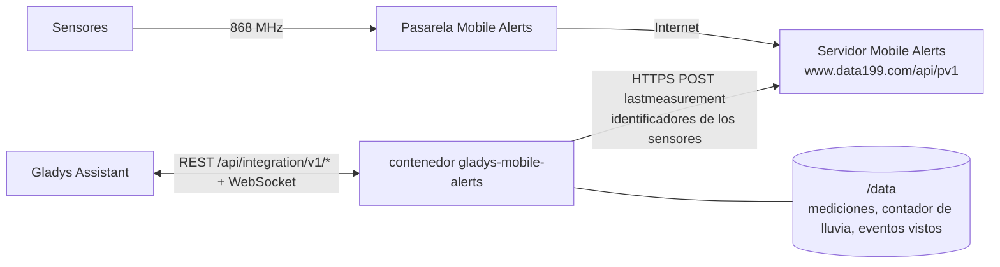
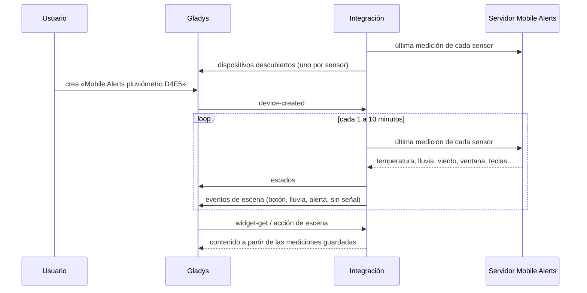
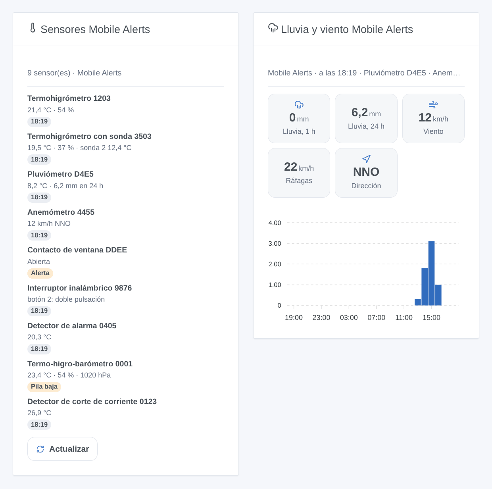

# Gladys Mobile Alerts

[English](README.md) · [Français](README.fr.md) · [Deutsch](README.de.md) · **Español**

[](LICENSE)
[](https://github.com/William-De71/gladys-mobile-alerts/releases)
[](https://github.com/William-De71/gladys-mobile-alerts/actions/workflows/release.yml)
[](https://gladysassistant.com)



Integración externa de [Gladys Assistant](https://gladysassistant.com) para los sensores **[Mobile Alerts](https://mobile-alerts.eu)** (vendidos por Technoline, La Crosse, ELV…): temperatura, humedad, lluvia, viento, contactos de ventana, interruptores inalámbricos y detectores de alarma, con escenas y widgets. Lee la API REST oficial de Mobile Alerts con los identificadores de sus sensores, sin ninguna cuenta.

## Funciones

- **Un dispositivo por sensor** (hasta 50), con el nombre de su tipo: temperaturas y humedades (sondas y sensores adicionales incluidos), calidad del aire, presión, lluvia de la última hora y de las últimas 24 horas, velocidad, ráfagas y dirección del viento, contacto de ventana, las cuatro teclas de un interruptor inalámbrico, alarmas de humo, pila baja.
- **4 desencadenantes de escena**, **1 acción de escena** y **2 widgets** (más abajo).
- Una petición cada 1 a 10 minutos (a elegir) lee todos los sensores, 20 identificadores por petición.
- Opcional: el Phone ID de la app Mobile Alerts convierte las alertas configuradas en la app en desencadenantes de escena.
- Solo lectura. Botones de configuración: leer ahora, diagnóstico.
- Cuatro idiomas en todas partes: inglés, francés, alemán, español.

## Funcionamiento





Los sensores envían sus mediciones por radio a la pasarela Mobile Alerts, que las transmite al servidor Mobile Alerts. La integración lee allí la última medición de cada sensor (`POST /device/lastmeasurement`). La API no puede listar sus sensores: usted indica sus identificadores. La lluvia de la última hora y de las últimas 24 horas sale del contador del pluviómetro, guardado 25 horas. Cada nueva medición se compara con la anterior para activar los desencadenantes de escena.

El servidor rechaza una petición entera por un solo identificador desconocido (400), y bloquea la dirección 15 minutos tras 5 peticiones no válidas en 15 minutos. Una petición rechazada se divide, por tanto, identificador a identificador, sin superar nunca 4 peticiones no válidas en 15 minutos; un identificador desconocido se deja de lado hasta un cambio de configuración o **Leer ahora**.



### Transporte

Solo nube (`"transports": ["cloud"]`): el catálogo muestra la insignia de nube. La integración contacta `www.data199.com` por HTTPS con los identificadores de sus sensores (y el Phone ID si lo indica); Mobile Alerts ya tiene sus mediciones. La pasarela no tiene API local, así que no hay botón «Preferir la conexión local».

## Dispositivos y funciones

| Función                                | Categoría / tipo               | Nota                                     |
| -------------------------------------- | ------------------------------ | ---------------------------------------- |
| Temperatura                            | `temperature-sensor/decimal`   | °C                                       |
| Temperatura (sonda 2 a 4)              | `temperature-sensor/probe`     | °C, fuera de la media de la habitación   |
| Humedad (y sondas 2 a 4)               | `humidity-sensor/decimal`      | %                                        |
| Calidad del aire (equivalente de CO₂)  | `co2-sensor/integer`           | ppm                                      |
| Presión atmosférica                    | `pressure-sensor/decimal`      | hPa                                      |
| Lluvia, última hora / últimas 24 horas | `precipitation-sensor/decimal` | mm/h, mm/día, a partir del contador      |
| Lloviendo                              | `rain-sensor/binary`           | lluvia en los últimos 30 minutos         |
| Velocidad del viento, ráfagas          | `speed-sensor/decimal`         | m/s                                      |
| Dirección del viento                   | `angle-sensor/decimal`         | grados, 16 sectores                      |
| Ventana                                | `opening-sensor/binary`        | 1 cerrada, 0 abierta                     |
| Humo                                   | `smoke-sensor/binary`          | detector de alarma, solo con el Phone ID |
| Botón 1 a 4                            | `button/click`                 | 1 clic, 2 doble clic, 6 clic largo       |
| Pila baja                              | `battery-low/binary`           |                                          |

Un dispositivo por sensor, `should_poll: false`, propuesto en cuanto respondió, con lo que mide. Una sonda no conectada no publica nada: no se inventa ningún valor. Una función propuesta no desaparece nunca. Los identificadores externos salen de una huella del identificador del sensor: el identificador en sí nunca aparece en Gladys.

## Desencadenantes, acciones de escena y widgets



**Desencadenantes**

- **Botón pulsado**: se pulsa una tecla de un interruptor inalámbrico. Filtros: sensor, botón (1-4), pulsación (corta, doble, larga). La pulsación se ve en la siguiente lectura (1 a 10 minutos).
- **Empieza a llover**: un pluviómetro cuenta lluvia tras al menos una hora sin ella.
- **Alerta de la app**: una alerta configurada en la app Mobile Alerts empieza o termina (temperatura, humedad, calidad del aire, presión, lluvia, viento, ventana, humo, corte de corriente). Requiere el Phone ID. Filtros: sensor, alerta, estado.
- **Sensor sin señal o de vuelta**: el servidor no recibe nada de un sensor desde hace 3 horas, o vuelve a recibir. Filtros: sensor, estado.

**Acción**: leer un sensor (todos los valores, hora, con señal o no, frase `summary`).

**Widgets**: **Sensores Mobile Alerts** (cada sensor con sus valores y una insignia: sin señal, humo, pila baja, alerta, o la hora; Actualizar) y **Lluvia y viento Mobile Alerts** (lluvia de la última hora y de 24 horas, viento, ráfagas, dirección, lluvia por hora).

**Ejemplos**

- Cuando **se pulsa dos veces el botón 1 del interruptor** → la escena «Película».
- Cuando **empieza a llover** → cerrar la ventana del tejado y avisar.
- Cuando **la ventana de la cocina se queda abierta demasiado tiempo** (alerta de la app) → un mensaje.

## Requisitos

- Gladys Assistant **5.3.0** o posterior (palabras clave del catálogo). Las instancias más antiguas no pueden instalar la integración.
- Sensores Mobile Alerts y una pasarela Mobile Alerts (o un sensor que se conecta solo), configurados en la app Mobile Alerts.
- El identificador de cada sensor: 12 caracteres, en su etiqueta y en la app.

## Instalación

- **Desde la tienda** de Gladys (Integraciones → Integraciones externas), con un clic, una vez indexada.
- **Desde la URL del repositorio**: `https://github.com/William-De71/gladys-mobile-alerts`.
- **Modo desarrollador**: construya la imagen en local (`docker build -t gladys-mobile-alerts .`) e instálela desde Gladys.

## Configuración

| Campo                           | Por defecto | Función                                                                         |
| ------------------------------- | ----------- | ------------------------------------------------------------------------------- |
| Identificadores de los sensores | —           | El identificador de cada sensor, separados por comas o saltos de línea; 50 máx. |
| Phone ID de la app              | —           | Opcional (secreto): añade las alertas de la app y las alarmas de humo.          |
| Leer cada                       | 2 minutos   | 1, 2, 5 o 10 minutos.                                                           |
| Idioma de los textos            | automático  | Nombres de los dispositivos y textos de las escenas.                            |

## Uso

1. Introduzca los identificadores de sus sensores (y el Phone ID si quiere las alertas de la app) y guarde.
2. Pulse **Leer ahora** para ver los valores de cada sensor.
3. En la pestaña **Descubrir**, cree los dispositivos «Mobile Alerts …».
4. Añada los widgets **Sensores Mobile Alerts** y **Lluvia y viento Mobile Alerts** a un panel, y construya escenas con los desencadenantes de arriba.

## Desarrollo

```bash
npm install
npm test                       # node --test, sin tocar nunca la red
npm run lint && npm run format:check
npx github:GladysAssistant/integration-store . --skip-image-check
scripts/build-cover.sh         # cover.jpg a partir de docs/assets/cover.svg
docs/illustrations/render.sh   # docs/assets/widgets.<idioma>.png
node .github/scripts/release.mjs next
```

En local, el SDK lee `GLADYS_HOST_API_URL`, `GLADYS_INTEGRATION_TOKEN` y `GLADYS_INTEGRATION_SELECTOR`; `DEBUG=gladys-integration-sdk` muestra los registros del SDK y comprueba cada contenido de widget. Las pruebas usan un falso servidor Mobile Alerts que se comporta como el real (`test/helpers/fake-api.js`), según la [documentación de la API REST](https://mobile-alerts.eu/info/public_server_api_documentation.pdf). Las reglas del proyecto están en [CLAUDE.md](CLAUDE.md).

## Proceso de publicación


Cada fusión en `main` lanza la CI y luego calcula la versión a partir de los [Conventional Commits](https://www.conventionalcommits.org/) desde la última etiqueta: `feat` → menor, `fix` / `perf` → parche, `!` o `BREAKING CHANGE` → mayor (una menor por debajo de 1.0.0); `docs`, `chore`, `ci`, `test`, `style`, `refactor`, `build` solos no publican nada. Se genera la sección del changelog, se envía la etiqueta, se construye la imagen multiarquitectura, luego `main` recibe el commit de versión, se crea la GitHub Release y un último job comprueba la imagen pública, el validador de la tienda y el topic.

- El título de la pull request se convierte en el commit squash y luego en la línea del changelog: escríbalo en inglés, para el usuario (`pr-title.yml` lo comprueba). No edite nunca `CHANGELOG.md` a mano.
- La 1.0.0 es una decisión: Actions → Release → Run workflow con `release-as: 1.0.0`. `dry-run` muestra la versión y las notas sin publicar.
- **Rama protegida**: la publicación envía su commit a `main` con `GITHUB_TOKEN`. Con un ruleset que exija pull requests o comprobaciones en `main`, añada GitHub Actions a su lista de omisión (o envíe mediante una GitHub App); si no, el job de publicación falla con instrucciones.
- Tras la primera publicación, haga público el paquete `ghcr.io` (Package settings → Change visibility); si no, Gladys no puede descargarlo.

## Solución de problemas

Vea [docs/es.md](docs/es.md#solución-de-problemas). Informe de los problemas con las versiones de Gladys y de la integración, y las líneas del botón **Diagnóstico**.

## Contribuir

Issues y pull requests bienvenidas. Ejecute `npm run format:check && npm run lint && npm test` antes de abrir una pull request, y mantenga sin cambios todos los identificadores externos y claves guardadas (vea [CLAUDE.md](CLAUDE.md)).

## Seguridad

Vea [SECURITY.md](SECURITY.md): informe de las vulnerabilidades en privado. Los identificadores de los sensores dan acceso a sus mediciones: solo se envían a `www.data199.com` por HTTPS, y los registros, el diagnóstico y `/data` solo muestran los cuatro últimos caracteres de un identificador o su huella. El Phone ID es un campo `secret` de Gladys, nunca registrado. La integración funciona en solo lectura, sin privilegios de root, en su contenedor.

## Capturas por venir

Las imágenes de arriba son ilustraciones, no capturas de pantalla. Las capturas reales irán en `docs/assets/screenshots/` (PNG, 1280 × 800): `configuration.png`, `discovery.png`, `device.png`, `scene.png`.

## Licencia

[Apache License 2.0](LICENSE) — vea también [NOTICE](NOTICE). Datos proporcionados por Mobile Alerts; esta integración no está afiliada a Mobile Alerts, Technoline ni La Crosse. Gracias a la documentación y al SDK de Gladys, y a Mobile Alerts por su API REST pública.
