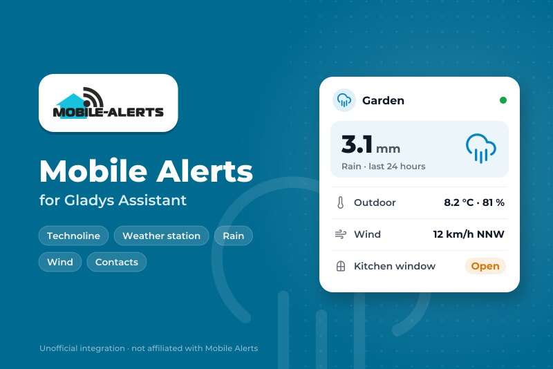
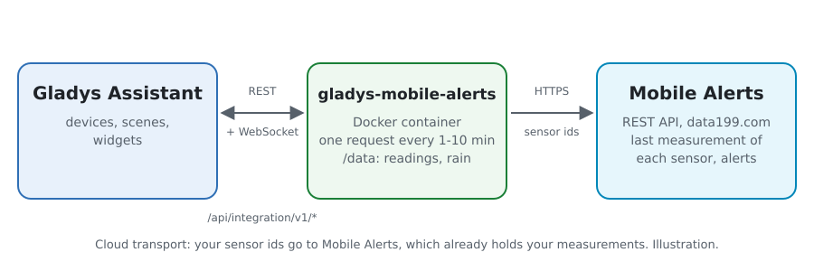
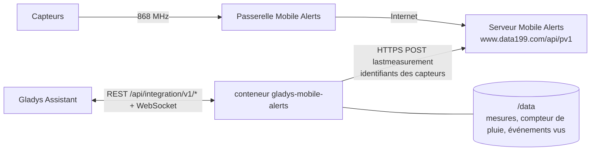
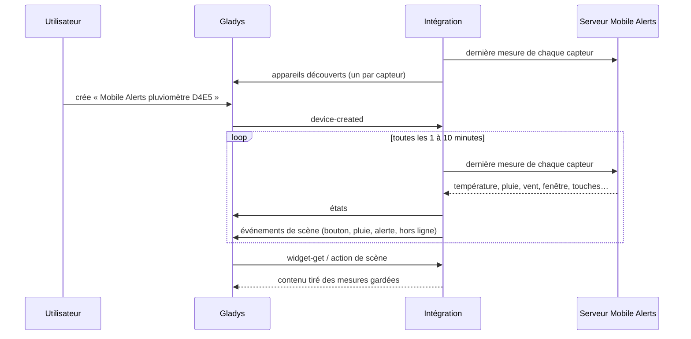
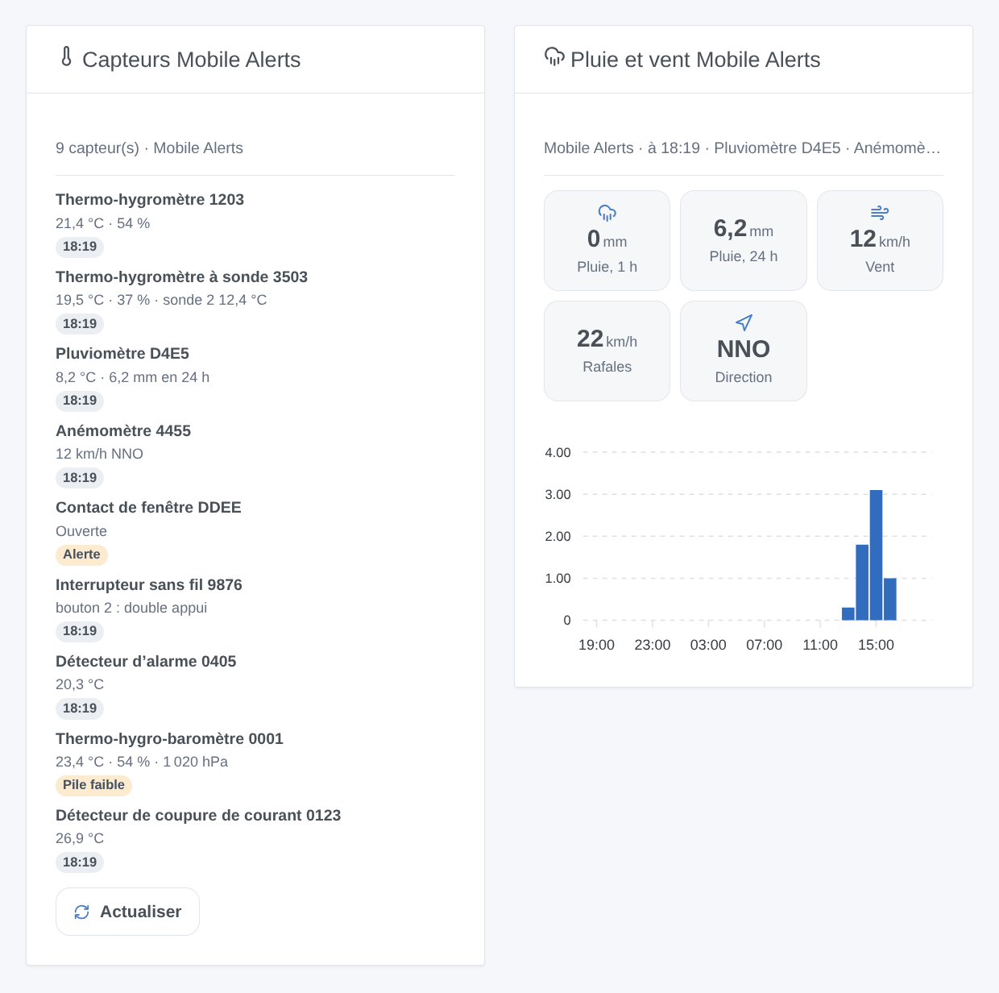

# Gladys Mobile Alerts

[English](README.md) · **Français** · [Deutsch](README.de.md) · [Español](README.es.md)

[](LICENSE)
[](https://github.com/William-De71/gladys-mobile-alerts/releases)
[](https://github.com/William-De71/gladys-mobile-alerts/actions/workflows/release.yml)
[](https://gladysassistant.com)



Intégration externe [Gladys Assistant](https://gladysassistant.com) pour les capteurs **[Mobile Alerts](https://mobile-alerts.eu)** (vendus par Technoline, La Crosse, ELV…) : température, humidité, pluie, vent, contacts de fenêtre, interrupteurs sans fil et détecteurs d’alarme, avec des scènes et des widgets. Elle lit l’API REST officielle de Mobile Alerts avec les identifiants de vos capteurs, sans aucun compte.

## Fonctionnalités

- **Un appareil par capteur** (jusqu’à 50), nommé d’après son type : températures et humidités (sondes et capteurs supplémentaires compris), qualité de l’air, pression, pluie de la dernière heure et des dernières 24 heures, vitesse, rafales et direction du vent, contact de fenêtre, les quatre touches d’un interrupteur sans fil, alarmes fumée, pile faible.
- **4 déclencheurs de scène**, **1 action de scène** et **2 widgets** (plus bas).
- Une requête toutes les 1 à 10 minutes (au choix) lit tous les capteurs, 20 identifiants par requête.
- Facultatif : le Phone ID de l’appli Mobile Alerts transforme les alertes réglées dans l’appli en déclencheurs de scène.
- Lecture seule. Boutons de configuration : lire maintenant, diagnostic.
- Quatre langues partout : anglais, français, allemand, espagnol.

## Fonctionnement





Les capteurs envoient leurs mesures par radio à la passerelle Mobile Alerts, qui les transmet au serveur Mobile Alerts. L’intégration y lit la dernière mesure de chaque capteur (`POST /device/lastmeasurement`). L’API ne sait pas lister vos capteurs : vous donnez leurs identifiants. La pluie de la dernière heure et des dernières 24 heures vient du compteur du pluviomètre, gardé 25 heures. Chaque nouvelle mesure est comparée à la précédente pour déclencher les scènes.

Le serveur refuse toute une requête pour un seul identifiant inconnu (400), et bloque l’adresse 15 minutes après 5 requêtes invalides en 15 minutes. Une requête refusée est donc découpée, identifiant par identifiant, sans jamais dépasser 4 requêtes invalides en 15 minutes ; un identifiant inconnu est mis de côté jusqu’à un changement de configuration ou **Lire maintenant**.



### Transport

Cloud uniquement (`"transports": ["cloud"]`) : le catalogue affiche le badge cloud. L’intégration contacte `www.data199.com` en HTTPS avec les identifiants de vos capteurs (et le Phone ID si vous le donnez) ; Mobile Alerts détient déjà leurs mesures. La passerelle n’a pas d’API locale : il n’y a donc pas de bouton « Préférer la connexion locale ».

## Appareils et fonctionnalités

| Fonctionnalité                         | Catégorie / type               | Remarque                                       |
| -------------------------------------- | ------------------------------ | ---------------------------------------------- |
| Température                            | `temperature-sensor/decimal`   | °C                                             |
| Température (sonde 2 à 4)              | `temperature-sensor/probe`     | °C, hors de la moyenne de la pièce             |
| Humidité (et sondes 2 à 4)             | `humidity-sensor/decimal`      | %                                              |
| Qualité de l’air (équivalent CO₂)      | `co2-sensor/integer`           | ppm                                            |
| Pression atmosphérique                 | `pressure-sensor/decimal`      | hPa                                            |
| Pluie, dernière heure / dernières 24 h | `precipitation-sensor/decimal` | mm/h, mm/jour, d’après le compteur             |
| Pluie en cours                         | `rain-sensor/binary`           | pluie dans les 30 dernières minutes            |
| Vitesse du vent, rafales               | `speed-sensor/decimal`         | m/s                                            |
| Direction du vent                      | `angle-sensor/decimal`         | degrés, 16 secteurs                            |
| Fenêtre                                | `opening-sensor/binary`        | 1 fermée, 0 ouverte                            |
| Fumée                                  | `smoke-sensor/binary`          | détecteur d’alarme, avec le Phone ID seulement |
| Bouton 1 à 4                           | `button/click`                 | 1 clic, 2 double clic, 6 clic long             |
| Pile faible                            | `battery-low/binary`           |                                                |

Un appareil par capteur, `should_poll: false`, proposé dès qu’il a répondu, avec ce qu’il mesure. Une sonde non branchée ne publie rien : aucune valeur n’est inventée. Une fonctionnalité proposée ne disparaît jamais. Les identifiants externes viennent d’une empreinte de l’identifiant du capteur : l’identifiant lui-même n’apparaît jamais dans Gladys.

## Déclencheurs, actions de scène et widgets



**Déclencheurs**

- **Bouton appuyé** : une touche d’un interrupteur sans fil est appuyée. Filtres : capteur, bouton (1-4), appui (court, double, long). L’appui est vu à la lecture suivante (1 à 10 minutes).
- **Il commence à pleuvoir** : un pluviomètre compte de la pluie après au moins une heure sans.
- **Alerte de l’appli** : une alerte réglée dans l’appli Mobile Alerts commence ou se termine (température, humidité, qualité de l’air, pression, pluie, vent, fenêtre, fumée, coupure de courant). Phone ID requis. Filtres : capteur, alerte, état.
- **Capteur hors ligne ou de retour** : le serveur n’a rien reçu d’un capteur depuis 3 heures, ou reçoit de nouveau. Filtres : capteur, état.

**Action** : lire un capteur (toutes les valeurs, heure, en ligne ou non, phrase `summary`).

**Widgets** : **Capteurs Mobile Alerts** (chaque capteur avec ses valeurs et une pastille : hors ligne, fumée, pile faible, alerte, ou l’heure ; Actualiser) et **Pluie et vent Mobile Alerts** (pluie de la dernière heure et des 24 heures, vent, rafales, direction, pluie par heure).

**Exemples**

- Quand **le bouton 1 de l’interrupteur est appuyé deux fois** → la scène « Film ».
- Quand **il commence à pleuvoir** → fermer le velux et prévenir.
- Quand **la fenêtre de la cuisine reste ouverte trop longtemps** (alerte de l’appli) → un message.

## Prérequis

- Gladys Assistant **5.3.0** ou plus récent (mots-clés du catalogue). Les instances plus anciennes ne peuvent pas installer l’intégration.
- Des capteurs Mobile Alerts et une passerelle Mobile Alerts (ou un capteur qui se connecte seul), installés dans l’appli Mobile Alerts.
- L’identifiant de chaque capteur : 12 caractères, sur son étiquette et dans l’appli.

## Installation

- **Depuis le store** de Gladys (Intégrations → Intégrations externes), en un clic, une fois indexée.
- **Depuis l’URL du dépôt** : `https://github.com/William-De71/gladys-mobile-alerts`.
- **Mode développeur** : construisez l’image en local (`docker build -t gladys-mobile-alerts .`) et installez-la depuis Gladys.

## Configuration

| Champ                     | Défaut      | Rôle                                                                               |
| ------------------------- | ----------- | ---------------------------------------------------------------------------------- |
| Identifiants des capteurs | —           | L’identifiant de chaque capteur, séparés par des virgules ou des retours ; 50 max. |
| Phone ID de l’appli       | —           | Facultatif (secret) : ajoute les alertes de l’appli et les alarmes fumée.          |
| Lire toutes les           | 2 minutes   | 1, 2, 5 ou 10 minutes.                                                             |
| Langue des textes         | automatique | Noms des appareils et textes des scènes.                                           |

## Utilisation

1. Saisissez les identifiants de vos capteurs (et le Phone ID si vous voulez les alertes de l’appli), puis enregistrez.
2. Appuyez sur **Lire maintenant** pour voir les valeurs de chaque capteur.
3. Dans l’onglet **Découverte**, créez les appareils « Mobile Alerts … ».
4. Ajoutez les widgets **Capteurs Mobile Alerts** et **Pluie et vent Mobile Alerts** à un tableau de bord, et construisez des scènes avec les déclencheurs ci-dessus.

## Développement

```bash
npm install
npm test                       # node --test, sans jamais toucher au réseau
npm run lint && npm run format:check
npx github:GladysAssistant/integration-store . --skip-image-check
scripts/build-cover.sh         # cover.jpg depuis docs/assets/cover.svg
docs/illustrations/render.sh   # docs/assets/widgets.<langue>.png
node .github/scripts/release.mjs next
```

En local, le SDK lit `GLADYS_HOST_API_URL`, `GLADYS_INTEGRATION_TOKEN` et `GLADYS_INTEGRATION_SELECTOR` ; `DEBUG=gladys-integration-sdk` affiche les journaux du SDK et vérifie chaque contenu de widget. Les tests utilisent un faux serveur Mobile Alerts qui se comporte comme le vrai (`test/helpers/fake-api.js`), d’après la [documentation de l’API REST](https://mobile-alerts.eu/info/public_server_api_documentation.pdf). Les règles du projet sont dans [CLAUDE.md](CLAUDE.md).

## Processus de publication


Chaque fusion sur `main` lance la CI, puis calcule la version à partir des [Conventional Commits](https://www.conventionalcommits.org/) depuis le dernier tag : `feat` → mineure, `fix` / `perf` → corrective, `!` ou `BREAKING CHANGE` → majeure (une mineure tant qu’on est sous 1.0.0) ; `docs`, `chore`, `ci`, `test`, `style`, `refactor`, `build` seuls ne publient rien. La section du changelog est générée, le tag poussé, l’image multi-architecture construite, puis `main` reçoit le commit de version, la GitHub Release est créée et un dernier job vérifie l’image publique, le validateur du store et le topic.

- Le titre de la pull request devient le commit squash, puis la ligne du changelog : écrivez-le en anglais, pour l’utilisateur (`pr-title.yml` le vérifie). Ne modifiez jamais `CHANGELOG.md` à la main.
- La 1.0.0 est une décision : Actions → Release → Run workflow avec `release-as: 1.0.0`. `dry-run` affiche la version et les notes sans rien publier.
- **Branche protégée** : la publication pousse son commit sur `main` avec `GITHUB_TOKEN`. Avec un ruleset qui impose des pull requests ou des vérifications sur `main`, ajoutez GitHub Actions à sa liste de contournement (ou poussez par une GitHub App), sinon le job de publication échoue avec des instructions.
- Après la première publication, rendez le paquet `ghcr.io` public (Package settings → Change visibility), sinon Gladys ne peut pas le télécharger.

## Dépannage

Voir [docs/fr.md](docs/fr.md#dépannage). Signalez un problème avec les versions de Gladys et de l’intégration, et les lignes du bouton **Diagnostic**.

## Contribuer

Issues et pull requests bienvenues. Lancez `npm run format:check && npm run lint && npm test` avant d’ouvrir une pull request, et gardez inchangés tous les identifiants externes et clés stockées (voir [CLAUDE.md](CLAUDE.md)).

## Sécurité

Voir [SECURITY.md](SECURITY.md) : signalez les failles en privé. Les identifiants des capteurs donnent accès à leurs mesures : ils ne sont envoyés qu’à `www.data199.com` en HTTPS, et les journaux, le diagnostic et `/data` n’en montrent que les quatre derniers caractères ou une empreinte. Le Phone ID est un champ `secret` de Gladys, jamais journalisé. L’intégration tourne en lecture seule, sans droits root, dans son conteneur.

## Captures à venir

Les images ci-dessus sont des illustrations, pas des captures d’écran. Les vraies captures iront dans `docs/assets/screenshots/` (PNG, 1280 × 800) : `configuration.png`, `discovery.png`, `device.png`, `scene.png`.

## Licence

[Apache License 2.0](LICENSE) — voir aussi [NOTICE](NOTICE). Données fournies par Mobile Alerts ; cette intégration n’est affiliée ni à Mobile Alerts, ni à Technoline, ni à La Crosse. Merci à la documentation et au SDK de Gladys, et à Mobile Alerts pour son API REST publique.
