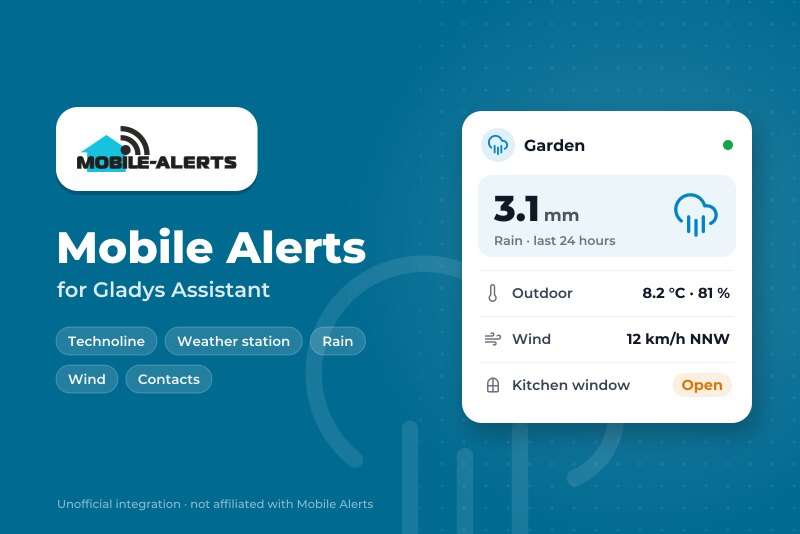
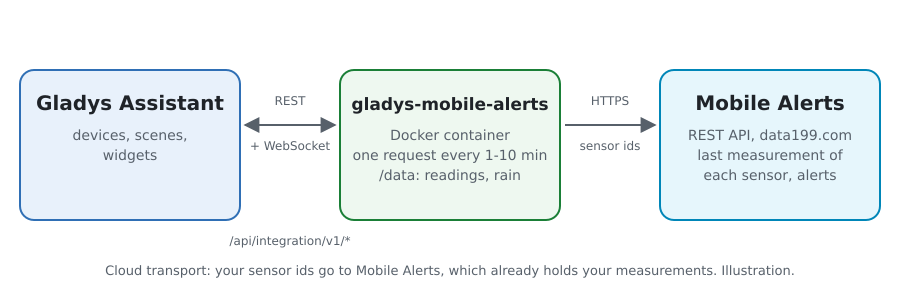
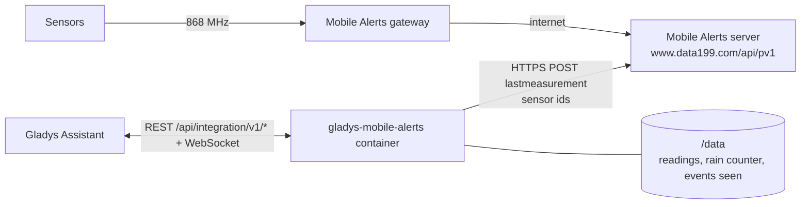
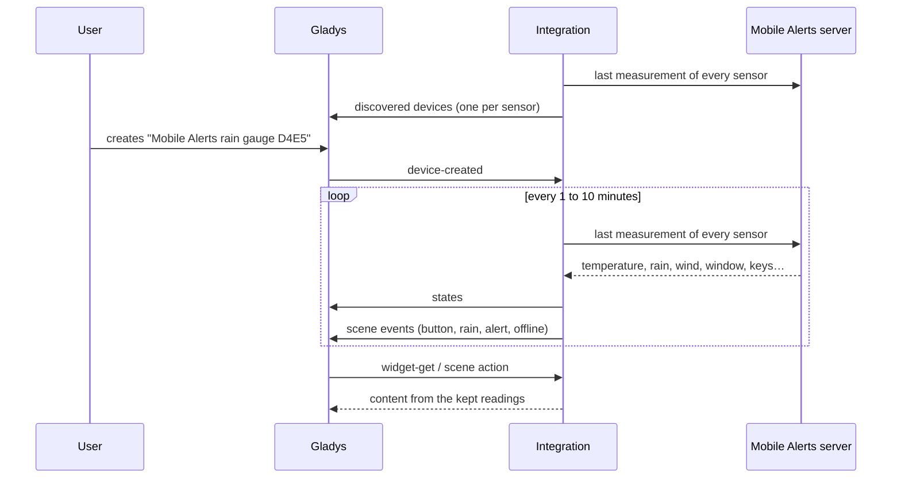
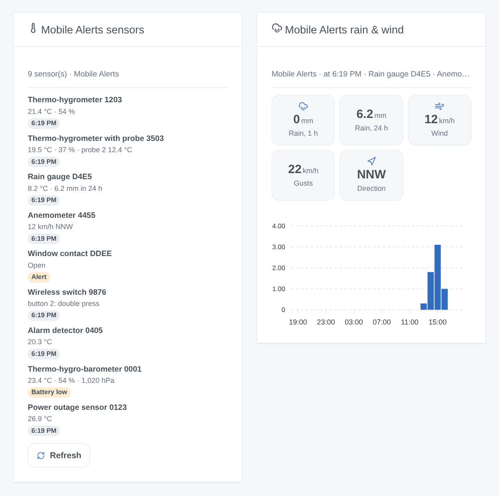

# Gladys Mobile Alerts

**English** · [Français](README.fr.md) · [Deutsch](README.de.md) · [Español](README.es.md)

[](LICENSE)
[](https://github.com/William-De71/gladys-mobile-alerts/releases)
[](https://github.com/William-De71/gladys-mobile-alerts/actions/workflows/release.yml)
[](https://gladysassistant.com)



[Gladys Assistant](https://gladysassistant.com) external integration for the **[Mobile Alerts](https://mobile-alerts.eu)** sensors (sold by Technoline, La Crosse, ELV…): temperature, humidity, rain, wind, window contacts, wireless switches and alarm detectors, with scenes and dashboard widgets. It reads the official Mobile Alerts REST API with the ids of your sensors, without any account.

## Features

- **One device per sensor** (up to 50), named after its kind: temperatures and humidities (probes and extra sensors included), air quality, pressure, rain of the last hour and of the last 24 hours, wind speed, gusts and direction, window contact, the four keys of a wireless switch, smoke alarms, low battery.
- **4 scene triggers**, **1 scene action** and **2 dashboard widgets** (below).
- One request every 1 to 10 minutes (your choice) reads every sensor, 20 ids a request.
- Optional: the phone id of the Mobile Alerts app turns the alerts you set in the app into scene triggers.
- Read only. Configuration buttons: read now, diagnostic.
- Four languages everywhere: English, French, German, Spanish.

## How it works





The sensors send their measurements by radio to the Mobile Alerts gateway, which forwards them to the Mobile Alerts server. The integration reads the last measurement of each sensor there (`POST /device/lastmeasurement`). The API cannot list your sensors: you give their ids. The rain of the last hour and of the last 24 hours comes from the counter of the rain gauge, kept for 25 hours. Each new measurement is compared with the previous one to fire the scene triggers.

The server refuses a whole request for one unknown id (400), and blocks the address for 15 minutes after 5 invalid requests in 15 minutes. A refused request is therefore split, id by id, without ever going past 4 invalid requests in 15 minutes; an unknown id is left out until the configuration changes or **Read now**.



### Transport

Cloud only (`"transports": ["cloud"]`): the catalog shows the cloud badge. The integration contacts `www.data199.com` over HTTPS with the ids of your sensors (and the phone id if you give it); Mobile Alerts already holds their measurements. The gateway has no local API, so there is no "prefer the local connection" button.

## Devices and features

| Feature                         | Category / type                | Note                                   |
| ------------------------------- | ------------------------------ | -------------------------------------- |
| Temperature                     | `temperature-sensor/decimal`   | °C                                     |
| Temperature (probe 2 to 4)      | `temperature-sensor/probe`     | °C, kept out of the room average       |
| Humidity (and probes 2 to 4)    | `humidity-sensor/decimal`      | %                                      |
| Air quality (CO₂ equivalent)    | `co2-sensor/integer`           | ppm                                    |
| Atmospheric pressure            | `pressure-sensor/decimal`      | hPa                                    |
| Rain, last hour / last 24 hours | `precipitation-sensor/decimal` | mm/h, mm/day, from the counter         |
| Raining                         | `rain-sensor/binary`           | rain within the last 30 minutes        |
| Wind speed, gusts               | `speed-sensor/decimal`         | m/s                                    |
| Wind direction                  | `angle-sensor/decimal`         | degrees, 16 sectors                    |
| Window                          | `opening-sensor/binary`        | 1 closed, 0 open                       |
| Smoke                           | `smoke-sensor/binary`          | alarm detector, with the phone id only |
| Button 1 to 4                   | `button/click`                 | 1 click, 2 double click, 6 long click  |
| Battery low                     | `battery-low/binary`           |                                        |

One device per sensor, `should_poll: false`, offered once it answered, with what it measures. A probe that is not connected publishes nothing: no value is invented. A feature, once offered, never goes away. External ids come from a hash of the sensor id: the id itself never shows in Gladys.

## Scene triggers, actions and widgets



**Triggers**

- **Button pressed**: a key of a wireless switch is pressed. Filters: sensor, button (1-4), press (short, double, long). The press shows at the next reading (1 to 10 minutes).
- **Rain started**: a rain gauge counts rain after at least an hour without any.
- **Alert of the app**: an alert set in the Mobile Alerts app starts or ends (temperature, humidity, air quality, pressure, rain, wind, window, smoke, power outage). Needs the phone id. Filters: sensor, alert, state.
- **Sensor offline or back**: the server has not received anything from a sensor for 3 hours, or receives again. Filters: sensor, state.

**Action**: read a sensor (every value, time, online or not, `summary` sentence).

**Widgets**: **Mobile Alerts sensors** (every sensor with its values and a badge: offline, smoke, battery low, alert, or the time; Refresh) and **Mobile Alerts rain & wind** (rain of the last hour and 24 hours, wind, gusts, direction, rain per hour).

**Examples**

- When **button 1 of the switch is pressed twice** → the "Movie" scene.
- When **it starts raining** → close the roof window and notify.
- When **the kitchen window stays open too long** (alert of the app) → a message.

## Requirements

- Gladys Assistant **5.3.0** or later (catalog keywords). Older instances cannot install the integration.
- Mobile Alerts sensors and a Mobile Alerts gateway (or a sensor that connects by itself), set up in the Mobile Alerts app.
- The id of each sensor: 12 characters, on its sticker and in the app.

## Installation

- **From the store** of Gladys (Integrations → External integrations), in one click, once indexed.
- **From the repository URL**: `https://github.com/William-De71/gladys-mobile-alerts`.
- **Developer mode**: build the image locally (`docker build -t gladys-mobile-alerts .`) and install it from Gladys.

## Configuration

| Field                 | Default   | Role                                                                |
| --------------------- | --------- | ------------------------------------------------------------------- |
| Sensor ids            | —         | The id of each sensor, separated by commas or new lines; up to 50.  |
| Phone id of the app   | —         | Optional (secret): adds the alerts of the app and the smoke alarms. |
| Read every            | 2 minutes | 1, 2, 5 or 10 minutes.                                              |
| Language of the texts | automatic | Device names and scene texts.                                       |

## Usage

1. Enter the ids of your sensors (and the phone id if you want the alerts of the app), then save.
2. Press **Read now** to see the values of each sensor.
3. In the **Discover** tab, create the "Mobile Alerts …" devices.
4. Add the **Mobile Alerts sensors** and **Mobile Alerts rain & wind** widgets to a dashboard, and build scenes with the triggers above.

## Development

```bash
npm install
npm test                       # node --test, never touches the network
npm run lint && npm run format:check
npx github:GladysAssistant/integration-store . --skip-image-check
scripts/build-cover.sh         # cover.jpg from docs/assets/cover.svg
docs/illustrations/render.sh   # docs/assets/widgets.<lang>.png
node .github/scripts/release.mjs next
```

Locally, the SDK reads `GLADYS_HOST_API_URL`, `GLADYS_INTEGRATION_TOKEN` and `GLADYS_INTEGRATION_SELECTOR`; `DEBUG=gladys-integration-sdk` shows the SDK logs and checks every widget content. The tests use a fake Mobile Alerts server that behaves like the real one (`test/helpers/fake-api.js`), after the [REST API documentation](https://mobile-alerts.eu/info/public_server_api_documentation.pdf). The rules of the project are in [CLAUDE.md](CLAUDE.md).

## Release process


Every merge on `main` runs the CI, then computes the version from the [Conventional Commits](https://www.conventionalcommits.org/) since the last tag: `feat` → minor, `fix` / `perf` → patch, `!` or `BREAKING CHANGE` → major (a minor below 1.0.0); `docs`, `chore`, `ci`, `test`, `style`, `refactor`, `build` alone publish nothing. The changelog section is generated, the tag pushed, the multi-architecture image built, then `main` receives the release commit, the GitHub Release is created and a last job checks the public image, the store validator and the topic.

- The pull request title becomes the squash commit, then the changelog line: write it in English, for the user (`pr-title.yml` checks it). Never edit `CHANGELOG.md` by hand.
- 1.0.0 is a decision: Actions → Release → Run workflow with `release-as: 1.0.0`. `dry-run` shows the version and the notes without publishing.
- **Protected branch**: the release pushes its commit to `main` with `GITHUB_TOKEN`. With a ruleset requiring pull requests or status checks on `main`, add GitHub Actions to its bypass list (or push through a GitHub App), otherwise the publish job fails with instructions.
- After the first release, make the `ghcr.io` package public (Package settings → Change visibility), or Gladys cannot pull it.

## Troubleshooting

See [docs/en.md](docs/en.md#troubleshooting). Report issues with the versions of Gladys and of the integration, and the lines of the **Diagnostic** button.

## Contributing

Issues and pull requests are welcome. Run `npm run format:check && npm run lint && npm test` before opening a pull request, and keep every external id and stored key unchanged (see [CLAUDE.md](CLAUDE.md)).

## Security

See [SECURITY.md](SECURITY.md): report vulnerabilities privately. The sensor ids give access to their measurements: they are sent only to `www.data199.com` over HTTPS, and the logs, the diagnostic and `/data` only show the last four characters of an id or its hash. The phone id is a `secret` field of Gladys, never logged. The integration runs read-only, as a non-root user, in its container.

## Screenshots to come

The images above are illustrations, not screenshots. Real screenshots will go in `docs/assets/screenshots/` (PNG, 1280 × 800): `configuration.png`, `discovery.png`, `device.png`, `scene.png`.

## License

[Apache License 2.0](LICENSE) — see also [NOTICE](NOTICE). Data provided by Mobile Alerts; this integration is not affiliated with Mobile Alerts, Technoline or La Crosse. Thanks to the Gladys documentation and SDK, and to Mobile Alerts for its public REST API.
