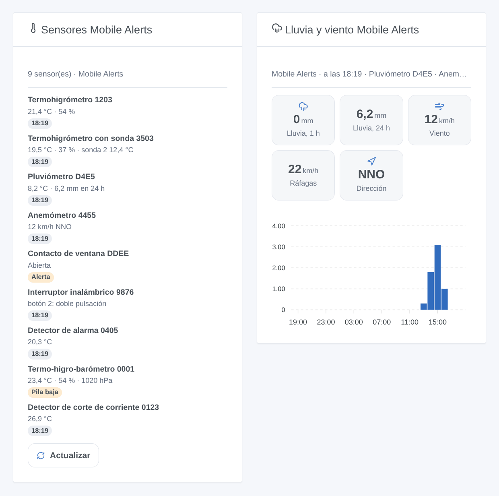

# Mobile Alerts

## Presentación

Esta integración lleva sus sensores **Mobile Alerts** (vendidos por Technoline, La Crosse, ELV…) a Gladys: termohigrómetros, pluviómetros, anemómetros, contactos de ventana, interruptores inalámbricos, detectores de alarma. Los sensores envían sus mediciones a través de la pasarela Mobile Alerts al servidor Mobile Alerts; la integración las lee allí con la API REST oficial, gracias a los identificadores de sus sensores. No hace falta ninguna cuenta.

Cada sensor se convierte en un dispositivo de Gladys con lo que mide. Los desencadenantes de escena reaccionan a una tecla pulsada en un interruptor inalámbrico, al comienzo de una lluvia, a las alertas configuradas en la app Mobile Alerts y a un sensor que deja de emitir. Dos widgets muestran todos los sensores de un vistazo, y la lluvia y el viento.

Datos proporcionados por Mobile Alerts. Esta integración no está afiliada a Mobile Alerts.

## Requisitos

- Gladys Assistant 5.3.0 o posterior.
- Sensores Mobile Alerts configurados con una pasarela Mobile Alerts en la app Mobile Alerts: si la app muestra sus valores, la integración puede leerlos.

### Encontrar el identificador de un sensor

El identificador tiene 12 caracteres (cifras y letras de la A a la F), por ejemplo `0E7EA4A71203`. Está impreso en la etiqueta del sensor, junto a su código QR, y la app lo muestra en el detalle del sensor. Sus dos primeros caracteres indican el tipo de sensor: `08` un pluviómetro, `0B` un anemómetro, `10` un contacto de ventana, `15` un interruptor inalámbrico…

### Encontrar el Phone ID (opcional)

La app muestra su **Phone ID** en sus ajustes. Indíquelo solo si quiere las alertas configuradas en la app (temperatura demasiado alta, ventana abierta demasiado tiempo, lluvia intensa…) como desencadenantes de escena, y las alarmas de humo de un detector de alarma.

## Configuración

| Campo                           | Función                                                                           |
| ------------------------------- | --------------------------------------------------------------------------------- |
| Identificadores de los sensores | El identificador de cada sensor, separados por comas o saltos de línea; hasta 50. |
| Phone ID de la app              | Opcional: añade las alertas de la app y las alarmas de humo.                      |
| Leer cada                       | 1, 2 (por defecto), 5 o 10 minutos.                                               |
| Idioma de los textos            | Nombres de los dispositivos y textos de las escenas; automático por defecto.      |

Guarde y pulse **Leer ahora**: el resultado muestra los valores de cada sensor, o lo que ha fallado.

## Uso

### Dispositivos

En **Descubrir**, cada sensor que respondió se propone como «Mobile Alerts _tipo_ _4 últimos caracteres de su identificador_», con lo que mide: temperaturas, humedades, calidad del aire, presión, lluvia de la última hora y de las últimas 24 horas, lloviendo, velocidad, ráfagas y dirección del viento, ventana (1 cerrada, 0 abierta), humo, botones 1 a 4, pila baja. Cree los que quiera.

### Widgets del panel

- **Sensores Mobile Alerts**: cada sensor con sus valores principales y una insignia (sin señal, humo, pila baja, alerta de la app, o la hora de la medición), y un botón **Actualizar**.
- **Lluvia y viento Mobile Alerts**: lluvia de la última hora y de las últimas 24 horas, viento, ráfagas y dirección (en km/h), y la lluvia de cada una de las últimas 24 horas. Elija el pluviómetro y el anemómetro, o déjelo vacío para los primeros.

### Escenas

Desencadenantes:

- **Botón pulsado**: una tecla de un interruptor inalámbrico, con la pulsación (corta, doble, larga). Se ve en la siguiente lectura.
- **Empieza a llover**: lluvia tras al menos una hora sin ella.
- **Alerta de la app**: una alerta configurada en la app empieza o termina (requiere el Phone ID).
- **Sensor sin señal o de vuelta**: nada recibido desde hace 3 horas, o de nuevo.

Acción: **leer un sensor** da sus valores y una frase `summary` para un mensaje.

Ejemplos: cuando se pulsa dos veces el botón 1 → la escena «Película»; cuando empieza a llover → cerrar la ventana del tejado; cuando la ventana de la cocina se queda abierta demasiado tiempo → un mensaje.

### Transporte

Solo nube: la integración contacta con el servidor Mobile Alerts (`www.data199.com`) por HTTPS con los identificadores de sus sensores. La pasarela no tiene API local.

## Solución de problemas

- **«El sensor …XXXX es desconocido para el servidor Mobile Alerts»**: compruebe el identificador en la etiqueta. Un sensor nuevo debe enviar primero una medición por la pasarela (véalo en la app). Luego pulse **Leer ahora**.
- **«El servidor Mobile Alerts bloqueó esta dirección 15 minutos»**: el servidor bloquea una dirección tras 5 peticiones no válidas en 15 minutos. La integración espera y vuelve a empezar sola; corrija mientras tanto los identificadores erróneos.
- **«El Phone ID fue rechazado»**: cópielo de nuevo desde los ajustes de la app. Las mediciones siguen llegando sin él.
- **Una pulsación llega con retraso**: el servidor solo la recibe con el siguiente mensaje de radio, y la integración lee cada 1 a 10 minutos: elija **1 minuto** para los interruptores.
- **Todavía no hay lluvia**: la lluvia se calcula a partir de dos mediciones del pluviómetro: aparecerá tras la próxima.
- Si no, pulse **Diagnóstico** y copie las líneas «Mobile Alerts diagnostic» de los registros en una issue: nunca contienen un identificador completo ni el Phone ID.
