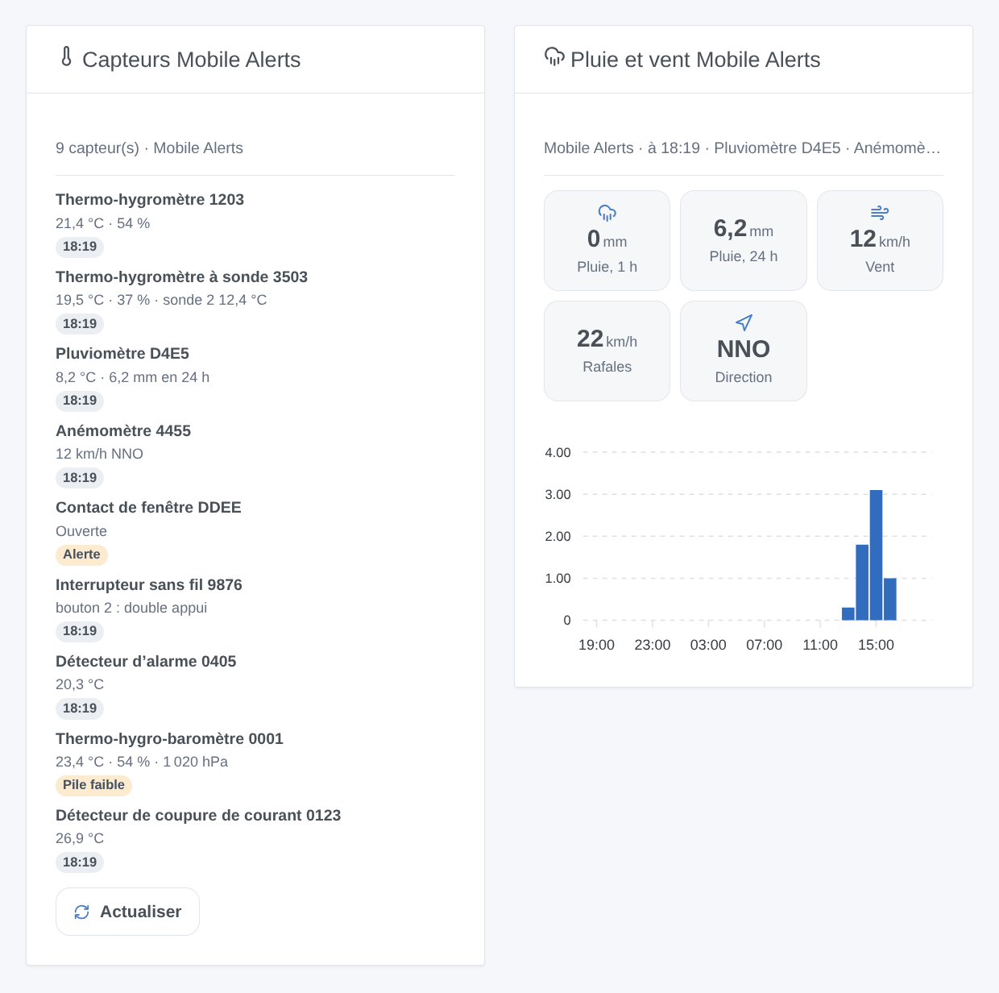

# Mobile Alerts

## Présentation

Cette intégration amène vos capteurs **Mobile Alerts** (vendus par Technoline, La Crosse, ELV…) dans Gladys : thermo-hygromètres, pluviomètres, anémomètres, contacts de fenêtre, interrupteurs sans fil, détecteurs d’alarme. Les capteurs envoient leurs mesures par la passerelle Mobile Alerts au serveur Mobile Alerts ; l’intégration les y lit avec l’API REST officielle, grâce aux identifiants de vos capteurs. Aucun compte n’est nécessaire.

Chaque capteur devient un appareil Gladys avec ce qu’il mesure. Des déclencheurs de scène réagissent à une touche appuyée sur un interrupteur sans fil, au début d’une pluie, aux alertes réglées dans l’appli Mobile Alerts et à un capteur devenu muet. Deux widgets montrent tous les capteurs d’un coup d’œil, et la pluie et le vent.

Données fournies par Mobile Alerts. Cette intégration n’est pas affiliée à Mobile Alerts.

## Prérequis

- Gladys Assistant 5.3.0 ou plus récent.
- Des capteurs Mobile Alerts installés avec une passerelle Mobile Alerts dans l’appli Mobile Alerts : si l’appli affiche leurs valeurs, l’intégration peut les lire.

### Trouver l’identifiant d’un capteur

L’identifiant compte 12 caractères (chiffres et lettres A à F), par exemple `0E7EA4A71203`. Il est imprimé sur l’étiquette du capteur, à côté de son QR code, et l’appli l’affiche dans le détail du capteur. Ses deux premiers caractères donnent le type de capteur : `08` un pluviomètre, `0B` un anémomètre, `10` un contact de fenêtre, `15` un interrupteur sans fil…

### Trouver le Phone ID (facultatif)

L’appli affiche son **Phone ID** dans ses réglages. Ne le donnez que si vous voulez les alertes réglées dans l’appli (température trop haute, fenêtre ouverte trop longtemps, forte pluie…) comme déclencheurs de scène, et les alarmes fumée d’un détecteur d’alarme.

## Configuration

| Champ                     | Rôle                                                                               |
| ------------------------- | ---------------------------------------------------------------------------------- |
| Identifiants des capteurs | L’identifiant de chaque capteur, séparés par des virgules ou des retours ; 50 max. |
| Phone ID de l’appli       | Facultatif : ajoute les alertes de l’appli et les alarmes fumée.                   |
| Lire toutes les           | 1, 2 (par défaut), 5 ou 10 minutes.                                                |
| Langue des textes         | Noms des appareils et textes des scènes ; automatique par défaut.                  |

Enregistrez, puis appuyez sur **Lire maintenant** : le résultat montre les valeurs de chaque capteur, ou ce qui ne va pas.

## Utilisation

### Appareils

Dans **Découverte**, chaque capteur qui a répondu est proposé sous le nom « Mobile Alerts _type_ _4 derniers caractères de son identifiant_ », avec ce qu’il mesure : températures, humidités, qualité de l’air, pression, pluie de la dernière heure et des dernières 24 heures, pluie en cours, vitesse, rafales et direction du vent, fenêtre (1 fermée, 0 ouverte), fumée, boutons 1 à 4, pile faible. Créez ceux que vous voulez.

### Widgets du tableau de bord

- **Capteurs Mobile Alerts** : chaque capteur avec ses valeurs principales et une pastille (hors ligne, fumée, pile faible, alerte de l’appli, ou l’heure de la mesure), et un bouton **Actualiser**.
- **Pluie et vent Mobile Alerts** : pluie de la dernière heure et des dernières 24 heures, vent, rafales et direction (en km/h), et la pluie de chacune des 24 dernières heures. Choisissez le pluviomètre et l’anémomètre, ou laissez vide pour les premiers.

### Scènes

Déclencheurs :

- **Bouton appuyé** : une touche d’un interrupteur sans fil, avec l’appui (court, double, long). Il est vu à la lecture suivante.
- **Il commence à pleuvoir** : de la pluie après au moins une heure sans.
- **Alerte de l’appli** : une alerte réglée dans l’appli commence ou se termine (Phone ID requis).
- **Capteur hors ligne ou de retour** : rien reçu depuis 3 heures, ou de nouveau.

Action : **lire un capteur** donne ses valeurs et une phrase `summary` pour un message.

Exemples : quand le bouton 1 est appuyé deux fois → la scène « Film » ; quand il commence à pleuvoir → fermer le velux ; quand la fenêtre de la cuisine reste ouverte trop longtemps → un message.

### Transport

Cloud uniquement : l’intégration contacte le serveur Mobile Alerts (`www.data199.com`) en HTTPS avec les identifiants de vos capteurs. La passerelle n’a pas d’API locale.

## Dépannage

- **« Le capteur …XXXX est inconnu du serveur Mobile Alerts »** : vérifiez l’identifiant sur l’étiquette. Un nouveau capteur doit d’abord envoyer une mesure par la passerelle (voyez-le dans l’appli). Appuyez ensuite sur **Lire maintenant**.
- **« Le serveur Mobile Alerts a bloqué cette adresse 15 minutes »** : le serveur bloque une adresse après 5 requêtes invalides en 15 minutes. L’intégration attend et repart seule ; corrigez entre-temps les identifiants erronés.
- **« Le Phone ID a été refusé »** : recopiez-le depuis les réglages de l’appli. Les mesures continuent d’arriver sans lui.
- **Un appui sur un bouton arrive en retard** : le serveur ne le reçoit qu’avec le message radio suivant, et l’intégration lit toutes les 1 à 10 minutes : choisissez **1 minute** pour les interrupteurs.
- **Pas encore de pluie** : la pluie se calcule à partir de deux mesures du pluviomètre : elle s’affiche après la prochaine.
- Sinon, appuyez sur **Diagnostic** et copiez les lignes « Mobile Alerts diagnostic » des journaux dans une issue : elles ne contiennent jamais un identifiant entier ni le Phone ID.
